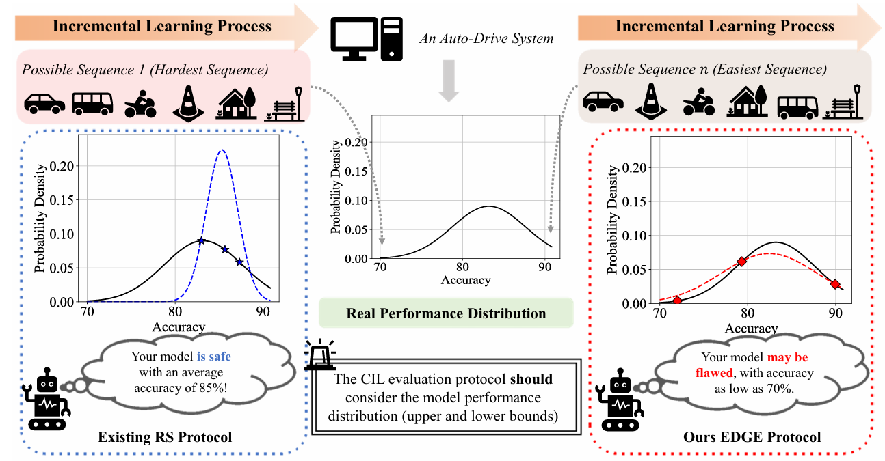
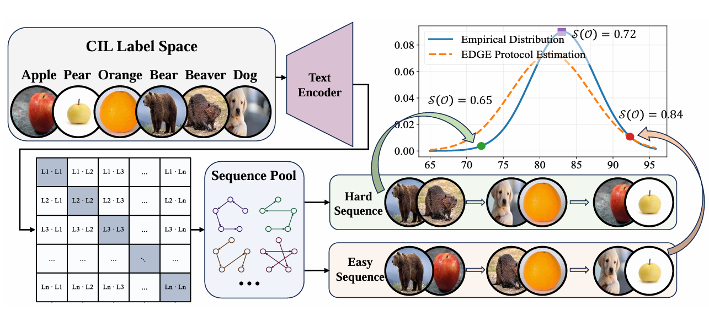

# EDGE: The Lie of the Average

### How Class Incremental Learning Evaluation Deceives You?

---

<p align="center">
  <a href="https://openreview.net/forum?id=19LHXi9uLw"></a>
  <a href="https://openreview.net/pdf?id=19LHXi9uLw"></a>
  <a href="https://arxiv.org/abs/2509.22580"></a>
  <a href="https://github.com/AIGNLAI/EDGE/stargazers"></a>
</p>

<p align="center">Official <b>ICLR 2026</b> implementation: evaluate class-incremental learners through performance distributions and extreme class orders.</p>

<p align="center">
  <a href="https://openreview.net/forum?id=19LHXi9uLw">Paper</a> ·
  <a href="https://openreview.net/pdf?id=19LHXi9uLw">PDF</a> ·
  <a href="#how-to-use">Get Started</a> ·
  <a href="#-citation">Citation</a> ·
  <a href="https://github.com/AIGNLAI/EDGE/issues">Issues</a>
</p>

<p align="center">
  <a href="https://www.lamda.nju.edu.cn/laign/">Guannan Lai</a> ·
  <a href="https://www.lamda.nju.edu.cn/zhoudw/">Da-Wei Zhou</a> ·
  <a href="https://it.swufe.edu.cn/info/1119/2300.htm">Xin Yang</a> ·
  <a href="https://www.lamda.nju.edu.cn/yehj/">Han-Jia Ye</a>
</p>

## 🎉 Introduction

<div align="center">
  
</div>

This repository contains the official implementation of **EDGE** (Extreme case–based Distribution & Generalization Evaluation), an evaluation protocol for **Class-Incremental Learning (CIL)**.

Mainstream CIL evaluation typically reports the *mean* (and sometimes variance) over only a small number of randomly sampled class sequences. However, CIL performance can vary substantially across sequences, and limited sampling may lead to **biased mean estimates** and a **severe underestimation** of the true variance in the performance distribution.

Our paper argues that robust CIL evaluation should characterize the **full performance distribution**, and introduces **extreme sequences** as a principled tool to approximate distributional boundaries efficiently.

## 🧊 EDGE Protocol

<div align="center">
  
</div>

EDGE evaluates a CIL method by estimating not only the central tendency but also the **distributional boundaries** (e.g., near-best / near-worst sequences).

At a high level, EDGE:

1. Computes or estimates **inter-task similarity** between incremental tasks/classes.
2. Uses the similarity signal to **search for extreme sequences**.
3. Samples sequences adaptively to better approximate the **true performance distribution**.

## 📰 What's New

- [2026-01] 🌟 Accepted by **ICLR 2026**
- [2025-10] 🌟 Initial release of EDGE evaluation code
- [2025-09] 🌟 [arXiv preprint](https://arxiv.org/abs/2509.22580) released

## How to Use

We integrate **EDGE** into two widely-used CIL toolboxes:
- **PILOT**: https://github.com/LAMDA-CL/LAMDA-PILOT  
- **PyCIL**: https://github.com/LAMDA-CL/PyCIL

This repo contains two subfolders, `PILOT/` and `PyCIL/`. Our main modifications include:
- Updating `main.py` and `trainer.py`
- Adding `utils/edge.py` (EDGE core logic)

EDGE is largely **decoupled** from the core training pipelines of PILOT and PyCIL. Therefore, if PILOT/PyCIL updates in the future, this integration can be adapted with minimal changes.

Concretely, we introduce an `--eval` argument:
- `--eval random`: the baseline using randomly sampled class orders
- `--eval edge`: the released implementation evaluates similarity-guided hard/easy class orders and a random order

Both entry points default to `--eval edge`. The trainers report maximum, minimum, mean, and standard deviation of accuracy over the evaluated sequences.

### 🕹️ Clone

```bash
git clone https://github.com/AIGNLAI/EDGE
cd EDGE
```

### 🗂️ Dependencies

- Python >= 3.8
- PyTorch >= 2.0
- torchvision
- timm
- numpy / scipy
- tqdm

> We recommend using a clean conda environment.

```bash
conda create -n edge python=3.10 -y
conda activate edge

# Example environment
pip install torch==2.0.0+cu118 torchvision==0.15.1+cu118 --extra-index-url https://download.pytorch.org/whl/cu118
pip install git+https://github.com/openai/CLIP.git
pip install scipy
pip install timm==0.6.12
pip install tqdm
```

### 🔑 Run with EDGE

Run commands from the selected toolbox directory. For example, from the repository root, use PILOT's ImageNet-R configuration:

```bash
cd PILOT
python main.py --config ./exps/simplecil_inr.json --eval edge
```

To use the random-sequence baseline:

```bash
python main.py --config ./exps/simplecil_inr.json --eval random
```

For PyCIL, run `cd PyCIL` from the repository root and choose a configuration in its `exps/` directory, using the same `--config` and `--eval` flags. Dataset preparation, model dependencies, and dataset paths are described in the [PILOT guide](PILOT/README.md) and [PyCIL guide](PyCIL/README.md).

**Dataset setup:** the released extreme-sequence search uses a fixed 200-class assumption. PILOT includes class-name lists for CIFAR-100, CUB-200, ImageNet-R, and ImageNet-A; PyCIL currently includes CIFAR-100 only. For a new dataset or a different class count, configure the class-name registry and class-count/search settings in the selected toolbox's `utils/edge.py` before using EDGE. The supplied 100-class configurations therefore need the search settings adjusted. Choose `init_cls` and `increment` in the experiment JSON to match the intended task partition.

Training logs are written under `logs/<model>/<dataset>/<init_cls>/<increment>/` within the selected toolbox. The summary describes the evaluated orders; consult the paper for the full evaluation protocol and experimental settings.

## 📚 Citation

If you find this repo useful, please consider citing:

```bibtex
@inproceedings{lai2026lie,
  title     = {The Lie of the Average: How Class Incremental Learning Evaluation Deceives You?},
  author    = {Lai, Guannan and Zhou, Da-Wei and Yang, Xin and Ye, Han-Jia},
  booktitle = {International Conference on Learning Representations (ICLR)},
  year      = {2026},
  url       = {https://openreview.net/forum?id=19LHXi9uLw}
}
```

## 👨‍🏫 Acknowledgments

We thank the following repos/projects for helpful components:

- PILOT
- PyCIL

## 🤗 Contact

For questions and feedback, please open an issue or contact:

- Guannan Lai ([laign@lamda.nju.edu.cn](mailto:laign@lamda.nju.edu.cn))

------

[](https://star-history.com/#AIGNLAI/EDGE&Date)

